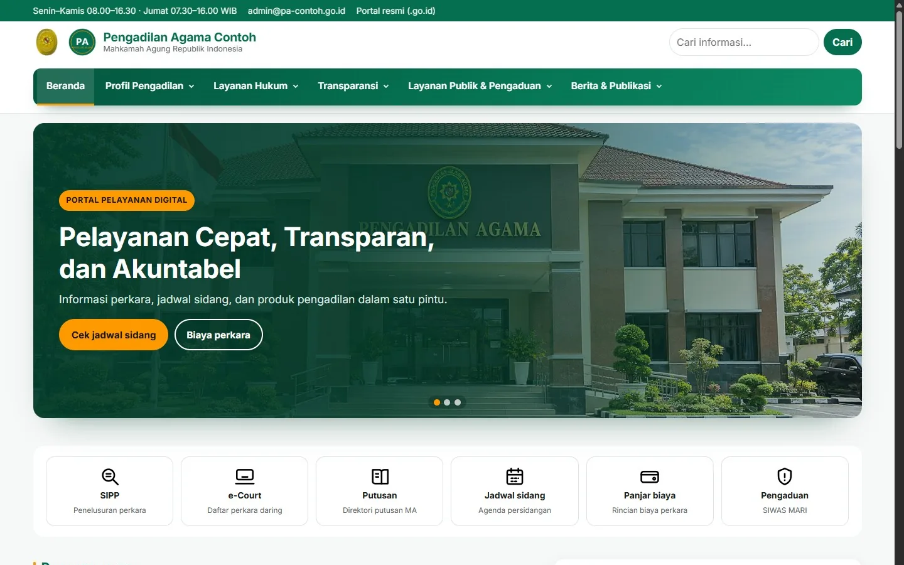
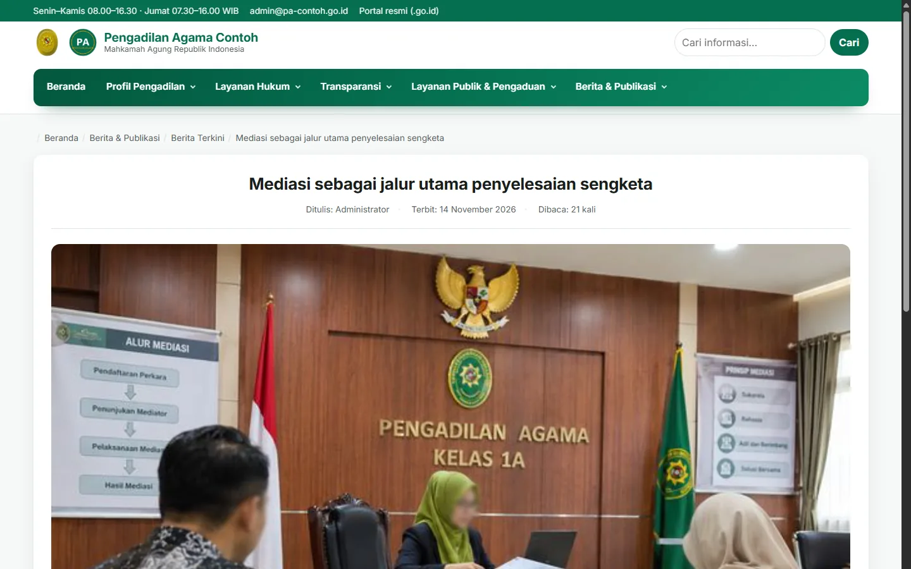
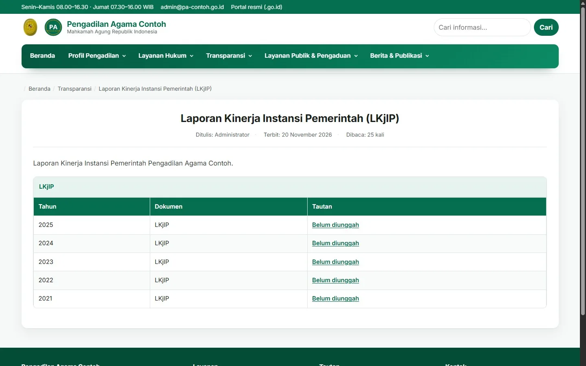

# Starterpack Website Satker Pengadilan Agama (Joomla 6.2)

Paket awal untuk membangun website resmi **Pengadilan Agama** yang mengikuti
**Keputusan Dirjen Badan Peradilan Agama Nomor 2722/DJA/SK.TI1/X/2026** tentang
Petunjuk Teknis Pembaruan, Tata Kelola, dan Evaluasi Website Satuan Kerja
(tanggal 12 Oktober 2026).

Isi paket: template Joomla 6.2 untuk tampilan publik, komponen penyedia data contoh
dan audit kepatuhan, tiga modul beranda, serta 35 halaman indikator SINOVA yang
sudah beralamat tetap dari menu item.

> Proyek komunitas, bukan produk resmi Mahkamah Agung RI atau Ditjen Badilag.
> Tampilan mengacu pada situs Badilag dan situs satker yang sudah berjalan.
> Logo resmi Mahkamah Agung RI tidak disertakan dalam paket; unggah sendiri
> melalui panel admin sesuai identitas satker.





## Daftar Isi

- [Fitur](#fitur)
- [Persyaratan](#persyaratan)
- [Instalasi pada situs Joomla 6.2 yang sudah ada](#instalasi-pada-situs-joomla-62-yang-sudah-ada)
- [Instalasi dari nol](#instalasi-dari-nol)
- [Jalur pengembang](#jalur-pengembang)
- [Langkah pertama setelah instalasi](#langkah-pertama-setelah-instalasi)
- [Memperbarui paket](#memperbarui-paket)
- [Lupa kata sandi admin](#lupa-kata-sandi-admin)
- [Keamanan dan checklist server](#keamanan-dan-checklist-server)
- [Struktur dan pengembangan](#struktur-dan-pengembangan)
- [Status dan rencana](#status-dan-rencana)
- [Kontribusi, lisensi, dan kredit](#kontribusi-lisensi-dan-kredit)

## Fitur

### Situs publik

- **Enam menu konsolidasi** sesuai Bab III huruf F: Beranda, Profil Pengadilan,
  Layanan Hukum, Transparansi, Layanan Publik & Pengaduan, Berita & Publikasi.
- **Satu URL tetap per kriteria SINOVA** (35 halaman), alamatnya lahir dari menu item
  dan bukan dari alias artikel. Judul artikel boleh berubah tanpa memindahkan tautan
  yang sudah diinput ke aplikasi SINOVA.
- **Beranda pola situs instansi**: kartu berita utama dengan ringkasan, pengumuman
  satu kolom berbadge tanggal, agenda sidang, galeri foto dengan lightbox, video
  klik-putar, sambutan Ketua, serta sidebar alih bahasa, jam kerja, survei, dan
  statistik kunjungan.
- **Halaman artikel pola Badilag**: judul di tengah, baris penulis, tanggal terbit,
  jumlah dibaca, gambar utama, isi satu kolom selebar konten.
- **Panel aksesibilitas**: perbesar teks, kontras tinggi, garis bawah tautan, dan
  pengaturan yang tersimpan antar halaman.
- **Tanpa CDN dan tanpa layanan berbayar**: CSS, JavaScript, ikon, dan font
  di-host sendiri; tidak ada permintaan ke domain pihak ketiga.
- **Placeholder terhitung mesin**: tautan dokumen yang belum ada ditandai
  `<a href="#" data-pa-kosong="1">`, sehingga jumlah dokumen kurang bisa dihitung
  otomatis.

### Komponen `com_pastarter` di panel admin

| Bagian | Keterangan |
|---|---|
| Seeder data contoh | Membuat kategori, artikel berita dan pengumuman, 35 halaman indikator, menu, dan modul beranda dari manifest. Idempoten: jalan kedua tidak menggandakan data |
| Audit kepatuhan | Memeriksa 35 URL indikator: status HTTP, keberadaan judul, dan jumlah placeholder; menampilkan estimasi skor per kelompok penilaian |
| Manifest terbaca mesin | `manifest/indicators.json` (35 butir) dan `manifest/sections.json` (5 seksi) menjadi sumber tunggal untuk halaman, menu, dan pemeriksaan |

### Modul beranda

| Modul | Fungsi |
|---|---|
| `mod_pa_agenda` | Jadwal sidang dengan subform tanggal, jam, ruang, dan jenis perkara |
| `mod_pa_jamkerja` | Status layanan buka atau tutup berdasarkan hari dan jam kerja satker |
| `mod_pa_bahasa` | Tautan alih bahasa ke kanal resmi berbahasa Inggris |

## Persyaratan

| Komponen | Versi |
|---|---|
| Joomla | 6.2.x |
| PHP | 8.3 atau lebih baru untuk Joomla (diuji pada PHP 8.4), ekstensi `intl`, `mbstring`, `gd`, `mysqli`, `json`, `fileinfo` |
| Database | MariaDB 10.4+ atau MySQL 8.0.13+ |
| Web server | Apache 2.4 dengan `mod_rewrite`, Nginx, atau LiteSpeed |
| Composer | Hanya untuk pengembang (menjalankan tes) |

## Instalasi pada situs Joomla 6.2 yang sudah ada

Cara ini tidak memerlukan terminal. Cocok untuk satker yang situsnya sudah jalan
dan hanya ingin mengganti tampilan serta menambah halaman indikator.

1. Unduh berkas dari folder `dist/` pada repositori ini, atau bangun sendiri dengan
   `php tools/build.php`:

   ```
   dist/tpl_pa_satker.zip
   dist/com_pastarter.zip
   dist/mod_pa_agenda.zip
   dist/mod_pa_jamkerja.zip
   dist/mod_pa_bahasa.zip
   ```

2. Masuk ke panel admin Joomla, buka **System → Install → Extensions**.
3. Unggah kelima berkas satu per satu, atau seret semuanya sekaligus ke area unggah.
4. Buka **System → Site Templates**, pilih `pa_satker`, lalu klik **Default**.
5. Buka **Components → PA Starter**, jalankan **Seed data contoh**. Proses ini membuat
   kategori berita, artikel, 35 halaman indikator, menu, dan modul beranda.
6. Buka **Components → PA Starter → Audit**, lalu periksa hasilnya. Halaman yang masih
   memuat placeholder ditandai agar bisa dilengkapi.

Data contoh memakai nama "Pengadilan Agama Contoh". Ganti identitas satker sebelum
situs dibuka ke publik.

## Instalasi dari nol

1. Unduh Joomla 6.2 dari situs resmi Joomla, ekstrak ke folder situs
   (misalnya `public_html` atau `C:\xampp\htdocs\pa-contoh`).
2. Buat database kosong, misalnya `pa_satker`, dengan collation `utf8mb4_unicode_ci`.
3. Buka alamat situs di browser, ikuti pemasangan Joomla: pilih bahasa Indonesia,
   isi data database, buat akun Super User, lalu selesaikan pemasangan.
4. Hapus folder `installation/` bila installer belum melakukannya sendiri.
5. Pasang kelima paket dari `dist/` seperti pada bagian sebelumnya, lalu jalankan
   seeder dan audit.

Untuk server Linux, atur document root ke folder tempat Joomla dipasang, aktifkan
`mod_rewrite`, dan arahkan seluruh permintaan ke `index.php`. Contoh konfigurasi Nginx:

```nginx
server {
    listen 443 ssl;
    server_name pa-contoh.go.id;
    root /var/www/pa-contoh;
    index index.php;
    client_max_body_size 32m;

    location / {
        try_files $uri $uri/ /index.php?$args;
    }

    location ~ \.php$ {
        include snippets/fastcgi-php.conf;
        fastcgi_pass unix:/run/php/php8.4-fpm.sock;
    }

    location ~* /(cache|logs|tmp)/ {
        deny all;
    }
}
```

## Jalur pengembang

Prasyarat: PHP 8.4 (sesuai `composer.json` untuk tes dan pratinjau), Composer, MariaDB atau MySQL, dan Git.

```bash
git clone <alamat-repositori> pa-starterpack
cd pa-starterpack
composer install                      # hanya untuk PHPUnit

php tools/build.php                   # membangun dist/*.zip dari packages/
vendor/bin/phpunit                    # tes logika murni (23 tes)
python tools/assets.py --out=assets   # membuat ulang aset contoh
php tools/preview.php                 # pratinjau statis tanpa Joomla
```

Memasang paket ke situs uji dan menjalankan seeder lewat CLI Joomla:

```bash
php cli/joomla.php extension:install --path=D:/projects/pa-starterpack/dist/tpl_pa_satker.zip
php cli/joomla.php extension:install --path=D:/projects/pa-starterpack/dist/com_pastarter.zip

PA_MANIFEST=D:/projects/pa-starterpack/manifest PA_REFRESH=1 php cli/pa.php seed
PA_MANIFEST=D:/projects/pa-starterpack/manifest php cli/pa.php audit http://pa-contoh.test
```

`PA_REFRESH=1` menulis ulang isi artikel dan modul dari manifest, berguna saat
menyunting teks contoh. Tanpa variabel itu, seeder hanya mengisi data yang belum ada.

## Langkah pertama setelah instalasi

1. **System → Global Configuration → Site**: nama situs, meta description, dan
   alamat email resmi.
2. **System → Site Templates → pa_satker**: unggah logo Mahkamah Agung RI dan logo
   satker, lalu isi nama serta alamat pada parameter template.
3. **Components → PA Starter → Audit**: lihat butir yang belum selesai, lengkapi
   halaman yang masih memuat placeholder.
4. **Content → Articles**: ganti artikel contoh dengan berita kegiatan satker.
   Sertakan gambar utama agar kartu beranda tidak kosong.
5. **Menus → Main Menu**: sesuaikan label menu bila struktur satker berbeda.
   Alamat halaman indikator jangan diubah karena sudah dipakai sebagai bukti dukung
   di aplikasi SINOVA.
6. **Modules**: isi agenda sidang, jam kerja, dan tautan survei pada posisi
   `home-side`, `home-agenda`, dan `footer-2`.
7. **System → Manage → Plugins**: aktifkan `System - SEF` dan atur **System → Global
   Configuration → Site → SEO** (URL SEF, tambahkan akhiran, dan sebagainya).
8. Buka halaman beranda di ponsel untuk memastikan menu dan kartu berita tetap rapi.

## Memperbarui paket

```bash
git pull
php tools/build.php
```

Lalu unggah ulang paket yang berubah lewat **System → Install → Extensions**.
Jangan mengunggah ulang `com_pastarter` bila tidak ingin menjalankan seeder lagi;
data yang sudah ada tidak tertimpa karena seeder bersifat idempoten. Cadangkan
database sebelum memperbarui.

## Lupa kata sandi admin

Joomla menyediakan jalur resmi tanpa menyentuh database:

```bash
php cli/joomla.php user:reset-password --username=admin
```

Bila CLI tidak tersedia, buka `administrator/index.php`, klik **Lupa kata sandi**,
lalu ikuti tautan yang dikirim ke email admin. Alternatif terakhir: sunting tabel
`#__users` lewat phpMyAdmin dengan hash bcrypt baru dari
`password_hash('sandi-baru', PASSWORD_BCRYPT)`.

## Keamanan dan checklist server

Yang sudah ditangani paket:

| Ketentuan | Implementasi |
|---|---|
| Tanpa komponen pihak ketiga berbayar | Hanya ekstensi yang dibangun di repositori ini, semuanya berlisensi terbuka |
| Tanpa CDN | CSS, JavaScript, ikon, dan font berada di folder template |
| Validasi keluaran | Seluruh teks dinamis dicetak dengan `htmlspecialchars`, isi artikel melewati `content.prepare` Joomla |
| CSRF dan otentikasi | Memakai inti Joomla (token formulir, otentikasi, dan kontrol akses berbasis grup) |
| Placeholder terukur | Dokumen yang belum diunggah ditandai atribut, bukan tautan mati yang menyesatkan |
| Aksesibilitas | Struktur heading berurutan, teks alternatif gambar, panel perbesar teks dan kontras tinggi |

Tanggung jawab tim TI satker:

- PHP dan Joomla versi terbaru, tanpa ekstensi usang.
- HTTPS aktif dengan pengalihan dari HTTP, TLS 1.2 atau lebih baru.
- Database hanya mendengarkan `127.0.0.1` dan memakai akun khusus, bukan root.
- `display_errors` mati di produksi, log galat aktif.
- Backup berkas dan database terjadwal, disimpan di luar server.
- Panel admin dibatasi (IP allowlist atau autentikasi tambahan di web server).
- Folder `cache/`, `logs/`, `tmp/` tidak dapat diakses publik.

## Struktur dan pengembangan

```
manifest/
  indicators.json        # 35 butir SINOVA: id, seksi, path, kriteria, blok isi
  sections.json          # 5 seksi menu + halaman tambahan
  modules.json           # modul beranda: posisi, urutan, parameter
  *.html                 # fragmen HTML untuk modul kustom
packages/
  tpl_pa_satker/         # template: index.php, css, js, override com_content, modul
  com_pastarter/         # komponen admin: Seeder, Auditor, perender blok
  mod_pa_agenda/         # jadwal sidang
  mod_pa_jamkerja/       # status jam layanan
  mod_pa_bahasa/         # alih bahasa
assets/                  # gambar dan ikon hasil tools/assets.py
tools/                   # build.php, assets.py, preview.php, split-intro.sql
tests/                   # PHPUnit untuk logika murni
docs/screenshots/        # gambar pratinjau untuk README
dist/                    # hasil build (tidak masuk repositori)
```

Menambah satu butir indikator:

1. Tambahkan objek baru pada `manifest/indicators.json`: `id`, `no`, `title`,
   `section`, `path`, `criterion`, `checks`, dan `blocks`.
2. Jalankan `PA_MANIFEST=... php cli/pa.php seed` pada situs uji. Halaman, menu, dan
   artikel dibuat otomatis.
3. Jalankan `php cli/pa.php audit <url>` untuk memastikan halaman merespons 200 dan
   tidak menyisakan placeholder.

Mengubah tampilan:

1. Sunting `packages/tpl_pa_satker/css/template.css` atau override di
   `packages/tpl_pa_satker/html/`.
2. Jalankan `php tools/build.php`.
3. Unggah ulang `dist/tpl_pa_satker.zip` lewat **System → Install → Extensions**.
   Template langsung memakai berkas baru tanpa perlu diaktifkan ulang.

## Status dan rencana

| Bagian | Status |
|---|---|
| Manifest 35 butir + 5 seksi menu | selesai |
| Logika murni dan tes (23 tes, 38 asersi) | selesai |
| Template `pa_satker`: beranda, daftar kategori, halaman artikel, halaman indikator | selesai |
| Seeder idempoten: kategori, artikel, menu, modul | selesai |
| Auditor 35 URL dan estimasi skor | selesai (35 URL 200, 11 halaman tanpa placeholder) |
| Paket ekstensi `dist/*.zip` | selesai |
| Quickstart Joomla 6.2 (inti + data + installer satu klik) | belum, direncanakan versi 1.1 |
| Indeks pencarian `com_finder` | belum dibangun pada data contoh |
| Cakupan PTA | belum, menunggu parameter `satker_type` pada versi 1.1 |

## Kontribusi, lisensi, dan kredit

Koreksi dan tambahan dipersilakan. Untuk perubahan besar, buka issue terlebih
dahulu agar arahnya disepakati. Sertakan langkah uji yang sudah dijalankan
(`vendor/bin/phpunit`, `php cli/pa.php audit`) pada usulan perubahan.

Dirilis di bawah **GNU General Public License v2.0 atau lebih baru**, mengikuti
lisensi Joomla. Lihat berkas [LICENSE](LICENSE).

Kredit: Joomla (GPL-2.0-or-later) sebagai inti aplikasi. Desain tampilan mengacu
pada situs Direktorat Jenderal Badan Peradilan Agama dan situs satker yang sudah
berjalan. Seluruh gambar contoh dibuat sendiri melalui `tools/assets.py`; logo
Mahkamah Agung RI tidak disertakan dan diunggah oleh masing-masing satker.
